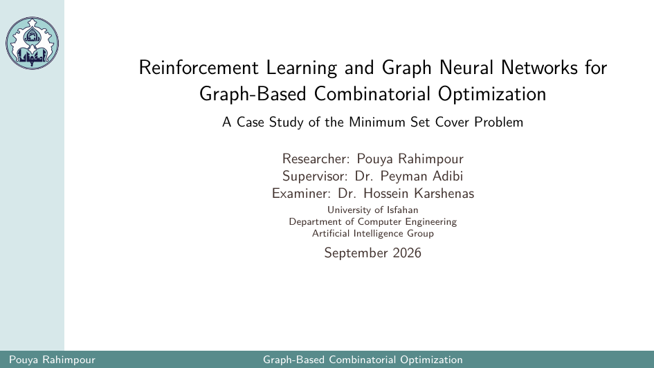

# PDNAR-GNARL-MSC

This repository is a fork of PDNAR repository. I explored neural approaches to the **Minimum Set Cover (MSC)** problem inspired from PDNAR and GNARL papers. It is my B.Sc final project. It supports dataset generation, behavioral cloning (BC), PPO training, evaluation, and model comparison.

## Project Overview

For a more detailed explanation of the motivation, architecture,
and methodology, see the project presentation.

[](presentation.pdf)

**[Read the full presentation (PDF)](presentation.pdf)**

## 1. Installation

Clone the repository and create the Conda environment:

```bash
git clone https://github.com/PouyaRahimpour/PDNAR-GNARL-MSC.git
cd PDNAR-GNARL-MSC

conda env create -f environment.yml
conda activate pdgnn
```

The environment specifies Python 3.10 and PyTorch/PyTorch Geometric dependencies.

## 2. Project Structure

| Path | Purpose |
|---|---|
| `conf/` | Hydra configuration files |
| `src/dataset/` | Graph generation, algorithm implementations, and dataset preparation |
| `src/gnarl/models/` | GNARL-MSC model architecture |
| `src/gnarl/envs/` | MSC decision-making environment |
| `src/gnarl/experts/` | Expert policy based on optimal set-cover solutions |
| `src/gnarl/training/` | BC and PPO training implementations |
| `src/gnarl/evaluation/` | GNARL evaluation utilities |
| `src/model/` | PDNAR model implementation |
| `scripts/` | Training, evaluation, dataset generation, and comparison entry points |
| `dataset/` | Generated datasets |
| `runs/` | Model checkpoints, logs, and evaluation outputs |

## 3. Dataset Generation

Generate the default MSC datasets using the project's Hydra entry point:

```bash
python main.py data.algorithm=set_cover
```

The default configuration uses 1,000 training instances, 100 validation instances, and 100 test instances. Training graphs have size 16; test graphs have sizes 16, 32, 64, 128, 256, 512, and 1024.

Datasets are stored under `dataset/set_cover/`.

## 4. Training

### Behavioral cloning

```bash
python scripts/train_bc.py
```

Useful options:

```bash
python scripts/train_bc.py --epochs 20 --lr 0.001
```

The default checkpoint is `runs/gnarl_msc_bc.pt`.

### PPO

```bash
python scripts/train_ppo.py --steps 100000
```

To initialize PPO from a checkpoint:

```bash
python scripts/train_ppo.py \
  --checkpoint runs/gnarl_msc_bc.pt \
  --steps 100000
```

The default checkpoint is `runs/gnarl_msc_ppo.pt`.

Both scripts load the training split for 1,000 instances of size 16. Ensure that this dataset exists before training.

Use `--device cuda` when a compatible CUDA setup is available; otherwise, the default is CPU.

## 5. Evaluation

### Evaluate a GNARL-MSC checkpoint

```bash
python scripts/evaluate.py runs/gnarl_msc_bc.pt
```

Specify graph sizes or output directory:

```bash
python scripts/evaluate.py runs/gnarl_msc_bc.pt \
  --sizes 16 32 64 128 \
  --output-dir runs/evaluation_bc
```

### Evaluate a PDNAR checkpoint

```bash
python scripts/evaluate_pdnar.py path/to/pdnar_checkpoint.ckpt
```

Both evaluators expect test datasets under `dataset/set_cover/` by default. The expected filename for size \(n\) is `test_100_n.pkl`, for example `test_100_128.pkl`.

Evaluation produces per-instance results, plots, and a `summary.csv` in the specified output directory.

## 6. Out-of-Distribution (OOD) Evaluation

Generate OOD test datasets:

```bash
python scripts/generate_pdnar_ood.py \
  --b 3 8 \
  --sizes 16 128 512 1024 \
  --samples 50 \
  --seeds 10
```

Evaluate a PDNAR checkpoint on those datasets:

```bash
python scripts/evaluate_pdnar_ood.py path/to/pdnar_checkpoint.ckpt
```

The default OOD evaluator expects datasets under `dataset/pdnar_ood/`. Using `--samples 50` matches its expected filenames.

## 7. Comparing Models

After evaluating models, compare their summary CSV files:

```bash
python scripts/compare_models.py \
  --metric optimal_ratio \
  --results \
  BC=runs/evaluation_bc/summary.csv \
  PPO=runs/evaluation_ppo/summary.csv \
  --output-dir runs/model_comparison
```

Available metrics are `objective`, `optimal_ratio`, `classical_pd_ratio`, and `steps`.

## 8. Useful Notes

- Run commands from the repository root.
- Check each script's options with `--help`.
- Evaluation requires the relevant datasets and a compatible checkpoint.
- `optimal_ratio` is the predicted objective divided by the stored optimal objective. Lower is better, with 1 indicating an optimal solution.


